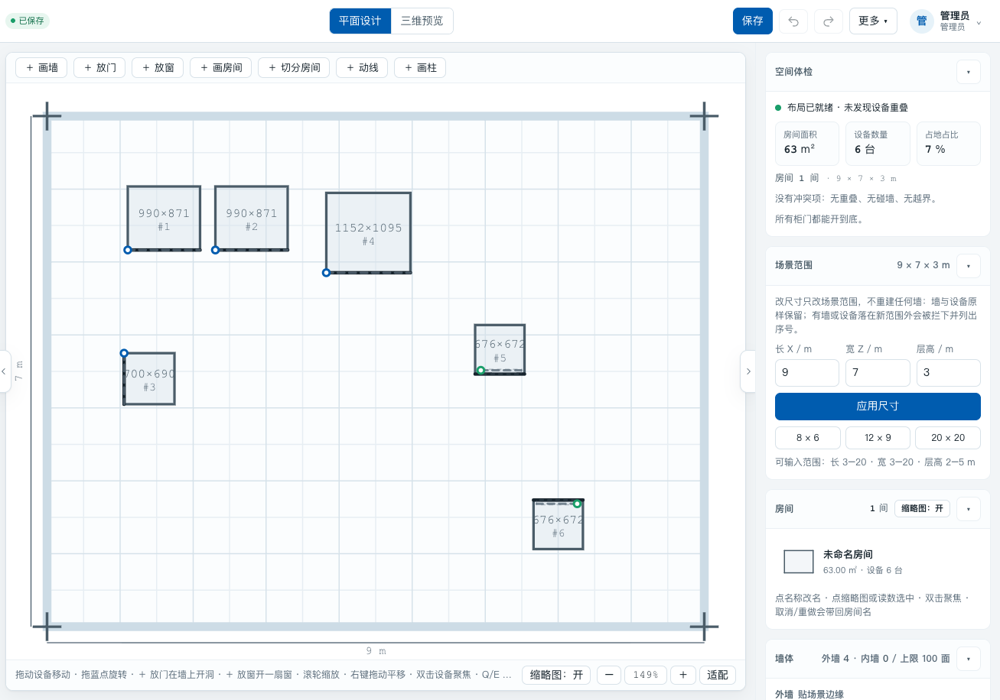
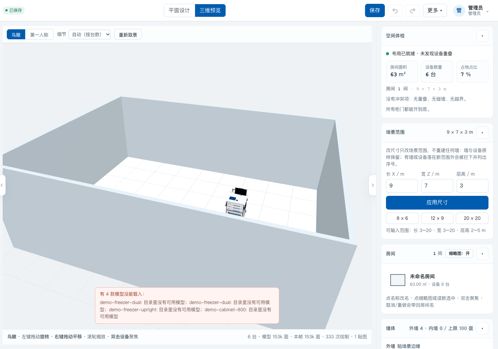
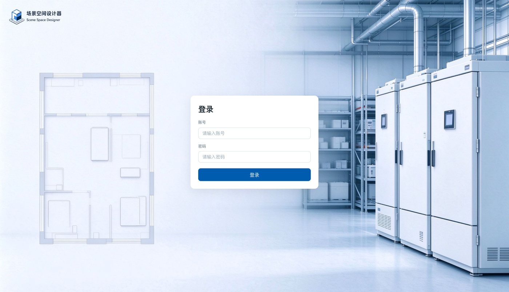

# 场景空间设计器 · Scene Space Designer

**面向工业装备制造销售厂家的「房间 + 设备」场景化空间设计交互工具** —— 在平面上把设备摆好，
切到三维立刻看到同一份数据立起来，摆完当场体检：碰墙、间距、开门净空、动线，每条结论都带原因和来源。

| 平面设计（2D） | 三维预览（3D） |
| --- | --- |
|  |  |

不只是「画个图」：设备尺寸、门开向、房间边界、间距规则是**同一份业务内核**说了算 ——
`spatial-core/` 是唯一规则真源，前端直接读它的源码，Java 后端是逐行移植件，两边跑**同一张用例表**
（`spatial-core/test/cases/rules.json`，47 条）对账。所以「界面上判过」和「服务端判过」是同一个结论，
不是两套各说各话的逻辑。



---

## 1. 它是什么样的东西 / What it is

- **单租户、内网、本机运行**：Vue 3 + Vite + Three.js 前端 ｜ Spring Boot（Java 21）后端 ｜ MySQL 8。
  没有 Docker、没有 CDN、没有云依赖 —— 一台机器上 `bash start.sh` 就能跑。
- **平面与三维是同一份数据**：2D 里拖一台设备，3D 里同一台就动了；改房间尺寸，两边一起变。
- **判据不是「看起来对不对」**：每条结论都能被问出来（为什么这台碰墙、为什么那扇门开不开），
  不静默过滤、不编假角标 —— 这是这个项目最较真的地方。
- **Python 只是离线工具**（模型管线），不是在线服务；在线后端只有 Java 一个。

## 2. 30 秒启动 / Quick start

前置：JDK 21、Maven 3.9+、MySQL 8.0、Node ≥ 20。

```bash
# 1) 建库（只需要一次；表由后端启动时的 Flyway 迁移建）
mysql -u root -h 127.0.0.1 < server/db/00-create-database.sql

# 2) 一键起（MySQL → 后端 8080 → 前端 5180）
bash start.sh

# 3) 设一个账号口令（仓库里没有任何默认口令）
bash tools/server/set-password.sh admin
```

然后打开 **http://127.0.0.1:5180** 登录。其它命令：

```bash
bash start.sh --status     # 看现状：谁在跑、库连没连上、内核表绿不绿
bash start.sh --no-db      # 不起库：数据只活在内存里，重启就没（功能会少一批，见 docs/RUNBOOK.md §2.3）
bash start-prod.sh         # 前端换成生产构建（:4180）
bash stop.sh               # 全停（前端 → 后端 → MySQL）
```

## 3. 一条命令验收 / Verify

```bash
bash tools/verify/gate.sh          # 内核单测 → 前端单测 → 后端测试 → 引号铁律 → 前端构建
bash tools/verify/gate.sh --list   # 只列步骤，不跑
```

退出码：`0` 全绿；`1` 有失败；**`2` = 环境不满足（不是通过）**。SKIP 会单独列出来 —— SKIP 不是 PASS。

单独跑某一层：

```bash
npm --prefix spatial-core test     # 规则内核（零依赖，node --test）
npm --prefix app test              # 前端（会连带再跑一遍内核）
cd server && mvn -B test           # 后端（需要真 MySQL：迁移要真的跑一遍）
bash tools/verify/check-secrets.sh  # 提交历史里的密钥扫描（gitleaks；CI 里是独立作业）
```

`check-secrets.sh` 的退出码 `2` 表示「本机没有 gitleaks、也下不下来」——**没验 ≠ 通过**，
CI（`.github/workflows/ci.yml` 的 `secrets` 作业）里这一条必须真跑。

仓库根有 `.gitleaks.toml`：默认规则 + 一条**按路径**的测试夹具白名单（目前只有
`app/test/api-csrf.test.js` 里的一个假令牌）。要放行别的东西请写清理由，别把规则关掉。

## 4. 目录结构 / Layout

```
app/            Vue 3 前端（2D 平面编辑器、3D 预览、维护端）
server/         Spring Boot 后端（目录、方案、判据、审计；Flyway 迁移在 db/migration/）
spatial-core/   业务内核（纯 JS，无框架无 DOM）：唯一规则真源 + 47 条用例表
tools/          构建与校验（gate.sh、check-quotes.py、check-secrets.sh、单 jar 打包）
docs/           架构、内核、模型管线、界面规范、运行手册、开发规范
assets/         演示模型（1 个 GLB）与合成目录清单
config/         参数默认值
```

## 5. 仓库里的演示数据 / Demo data

仓库随附 **6 款合成演示机型**（型号 `DEMO-*`，尺寸是演示值，**不是任何真实产品**）：

| 机型 | 型号 | 尺寸（w×d×h） | 3D 模型 |
| --- | --- | --- | --- |
| 样品搅拌机（演示） | `DEMO-BL-100` | 0.68 × 0.67 × 1.31 m | ✅ 随仓库（`assets/optimized/demo-blender-001.lod0.glb`） |
| CT 扫描仪（演示） | `DEMO-CT-100` | 3.05 × 2.47 × 2.14 m | — 刻意没有：用来说明「只有声明、没有模型」这条路 |
| 双温低温保存箱（演示） | `DEMO-FZ-040` | 0.99 × 0.87 × 1.98 m | — |
| 立式低温保存箱（演示） | `DEMO-FZ-25U` | 0.70 × 0.69 × 1.00 m | — |
| 卧式低温保存箱（演示） | `DEMO-FZ-25C` | 1.32 × 0.66 × 0.80 m | — |
| 立式保存箱（演示） | `DEMO-CB-800` | 1.15 × 1.09 × 1.99 m | — |

**另外 10 个合成模型**（机柜、离心机、机器人臂、CNC、液氮罐……约 48 MB）不放在仓库里，
放在 Release 附件里按需下载：

```bash
gh release download assets-v1 --repo ShenpingDD/scene-space-designer \
  --pattern '*.tar.gz' --dir /tmp/demo-models
tar -xzf /tmp/demo-models/scene-space-designer-demo-models-1.0.0.tar.gz -C .
# 解开后把 GLB 放进 assets/optimized/，把 models.verified.json 合并进 assets/catalog/
```

账号：`admin` / `designer` 会被迁移建出来，但**口令为空、`enabled=0`** ——
必须先 `bash tools/server/set-password.sh <登录名>` 设了口令才能登录（仓库里不含任何可用口令）。
角色门只挡界面，**不是安全边界**（本机单租户、内网使用）。

## 6. 文档 / Docs

| 文档 | 讲什么 |
| --- | --- |
| [`docs/ARCHITECTURE.md`](docs/ARCHITECTURE.md) | 分层、数据流、为什么这么切、已知取舍 |
| [`docs/KERNEL.md`](docs/KERNEL.md) | 业务内核：布局校验、墙与门、自动摆位、用例表怎么跑 |
| [`docs/MODEL-PIPELINE.md`](docs/MODEL-PIPELINE.md) | 模型管线：GLB → 尺寸/门几何 → 目录清单 |
| [`docs/UI-SPEC.md`](docs/UI-SPEC.md) | 界面规范：角标、文案、状态三态、颜色与对比度 |
| [`docs/RUNBOOK.md`](docs/RUNBOOK.md) | 起停、排障、验收、打包、数据与迁移 |
| [`docs/DEVELOPMENT.md`](docs/DEVELOPMENT.md) | 开发规范：改动落在哪、迁移纪律、两条铁律 |
| [`docs/00-index.md`](docs/00-index.md) | 文档索引 + 代码里 `docs/NN` 编号锚点对照 |

代码注释里会看到 `docs/17 §2` 这种引用：那是**内部设计文档的编号锚点**，公开仓只随附上面 6 份，
编号对照见 `docs/00-index.md`。

## 7. 许可与商用 / License

- **源代码**：PolyForm Noncommercial License 1.0.0（**非商业使用**）—— **不是 OSI 认可的开源许可**，
  请不要把它称作「开源软件」。
- **文档、缩略图、本项目自有的演示模型**：CC BY-NC 4.0（署名 + 非商业）。
- **第三方依赖**：各自原始许可，见 [`THIRD_PARTY_LICENSES.md`](THIRD_PARTY_LICENSES.md)。
- **商业使用**（含企业内部生产环境、对外交付、SaaS）：需要单独授权，见 [`COMMERCIAL.md`](COMMERCIAL.md)。
- 名称与标识：见 [`TRADEMARKS.md`](TRADEMARKS.md)。

## 8. 已知边界 / Known limits

- **单租户、内网、本机**：没有多租户隔离、没有横向扩展、没有对象存储；别直接挂公网。
- **登录是门不是墙**：会话 + 角色只用来区分「能看什么」，不构成安全边界。
- **迁移不兼容历史库**：公开仓的迁移集与任何私有部署的库 checksum 不同 —— 请**从空库安装**。
- **演示数据是合成的**：型号、尺寸、门几何都是演示值；不要拿它当真实设备参数。
- **只随仓库发了 1 个模型**：其余 5 款机型在 3D 里只有声明占地，会明确提示「目录里没有可用模型」。

---

## English (short)

**Scene Space Designer** is a room-and-equipment spatial design tool for industrial equipment
manufacturers and sellers: lay equipment out on a 2D plan, switch to 3D and see the same data stand up,
then get an immediate check — wall collisions, clearances, door swing, walking routes — where every
verdict carries its reason and source.

- **Stack**: Vue 3 + Vite + Three.js · Spring Boot (Java 21) · MySQL 8. Single-tenant, intranet, runs on
  one machine; no Docker, no CDN, no cloud services.
- **One source of truth**: `spatial-core/` holds the business rules; the frontend imports it directly and
  the Java backend is a line-by-line port, both verified against the same 47-case table
  (`spatial-core/test/cases/rules.json`).
- **Quick start**: create the database (`mysql -u root -h 127.0.0.1 < server/db/00-create-database.sql`),
  run `bash start.sh`, set a password with `bash tools/server/set-password.sh admin`, open
  <http://127.0.0.1:5180>. No default password ships with the repository — accounts are seeded disabled.
- **Verify**: `bash tools/verify/gate.sh` (kernel + app + Java + quote rule + build). Exit `2` means the
  environment is unmet — that is a skip, not a pass.
- **Demo data**: six synthetic models (`DEMO-*`); only one GLB ships in the repository, the other ten
  synthetic models are attached to the `assets-v1` release
  (`gh release download assets-v1 --repo ShenpingDD/scene-space-designer`).
- **License**: source code under **PolyForm Noncommercial 1.0.0** — *not* an OSI-approved open source
  license; docs, thumbnails and our own demo models under CC BY-NC 4.0. Commercial use requires a separate
  license (`COMMERCIAL.md`).
- **Limits**: no multi-tenancy, no horizontal scaling, auth is a gate rather than a security boundary, and
  the migrations are not compatible with any private deployment — install into an empty schema.
