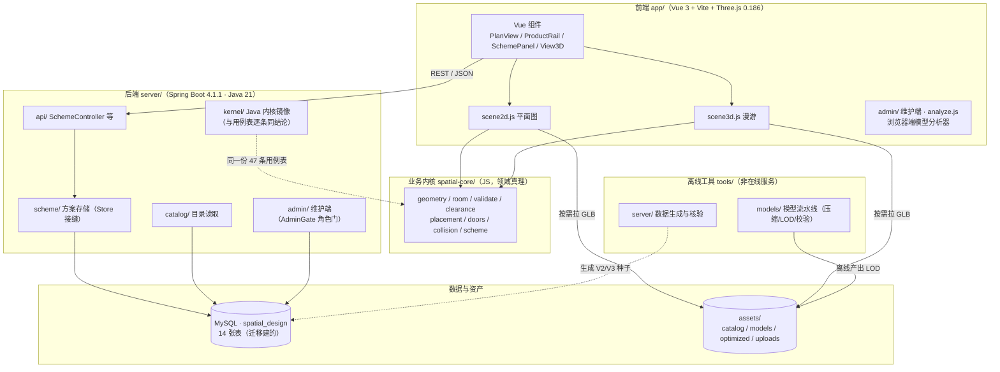
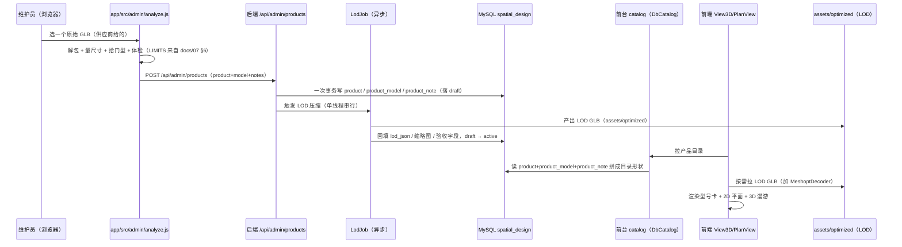

# 架构（ARCHITECTURE）

> 注：正文里的 `docs/NN`（如 `docs/17 §2`）是**内部设计文档的编号锚点**，用于保留决策沿革；公开仓只随附 `docs/` 下的 6 份文档，编号对照见 `docs/00-index.md`。


> 本文是**架构的唯一速览**。只写代码与留档里真有的东西，每条标注来源。
> 权威决策记录在 `docs/06-architecture-baseline.md`（ADR）；本文不替代它，只做分层 / 目录 / 数据组织的**现行快照**。
> 上游证据：`docs/06`、`docs/17`、`docs/18`、`docs/21`、`server/README.md`、`application.yml`、`V1__init.sql`、`ProductAdminController.java`、`app/src/admin/analyze.js`。

## ① 分层图



**两条最重要的线**（来源：`docs/06` §1）：

1. `spatial-core` 是**唯一规则真源**：前端 2D/3D **直接读它的源码**；Java `kernel/` 是**逐行移植件**，两边靠**同一份用例表**验收（`CaseRunner` 两侧各一份）—— **"必须一致"，不是"自动同步"**；
2. 前端（`S2D`/`S3D`）**直接拉静态 GLB**，不经 Java 中转——模型是静态资源，走 HTTP 不走业务 API（`docs/06` §1 原文）。

## ② 各层职责

| 层 | 技术栈 | 职责 | 来源 |
| --- | --- | --- | --- |
| `app/` | Vue 3 + Vite + Three.js 0.186 | 2D 平面图、3D 场景/漫游、方案管理面板、维护端；消费 `spatial-core`；**界面请求**一律走 `src/api.js`（模型二进制由 `gltf.js` 直接取 GLB —— 加载器要的是 URL，不经过 JSON 层） | `docs/06` §1、`docs/21` §1、`docs/22` §1 |
| `server/` | Spring Boot 4.1.1 · Java 21 | 方案 CRUD、目录读取、维护端接口、**服务端校验为唯一裁判**；不引 ORM、不引 Lombok | `docs/06` §1、`docs/18` §3 |
| `spatial-core/` | 纯 JS（零依赖） | **业务规则内核**，唯一规则真源；前端直接读源码，Java 侧为逐行移植件（靠同一份用例表对账） | `README.md`、`docs/06` §2 P1 |
| `tools/` | Node + Python（离线） | 离线工具：模型流水线、Java 数据生成、用例核验；**不是在线服务** | `README.md`、`docs/06` §4 ADR-0003 |
| `assets/` | 磁盘文件 | 模型与产物（catalog 元数据 / 原始 GLB / 优化后 LOD / 上传件） | `ls assets/`、`application.yml` |
| `config/` | `params.default.json` | 规则参数默认值（唯一真实来源；后端的参数种子由它生成） | `ls config/`、`server/README.md` §3 |

## ③ 目录树（含每目录一句话职责）

```
scene-space-designer/
├─ app/                        前端：Vue 3 + Vite + Three.js，静态包（源自 ls app/）
│  ├─ index.html / vite.config.js / package.json
│  ├─ public/                Vite 静态根（构建产物目录，上传件不放这）
│  ├─ scripts/               构建辅助：gen-doors.mjs / sync-assets.mjs
│  └─ src/
│     ├─ api.js              界面请求的唯一出口（Vite /api → 8080）；gltf.js 另取模型二进制
│     ├─ scene2d.js          2D 平面图（分级着色）
│     ├─ scene3d.js          3D 场景 / 漫游
│     ├─ gltf.js             数据层：加载 GLB、量尺寸、校准、绑门
│     ├─ catalog.js / data/  产品目录与门数据（doors.measured.js）
│     ├─ thumbs.js           缩略图
│     ├─ components/         Inspector / PlanView / ProductRail / SchemePanel / View3D
│     └─ admin/              维护端（AdminApp / analyze.js 模型分析器 / view.js / format.js）
├─ server/                     后端：Spring Boot 4.1.1 + Java 21（源自 ls server/）
│  ├─ pom.xml / serve.sh / dev-run.sh / db/00-create-database.sql
│  └─ src/main/java/com/scene/spatial/
│     ├─ XyApplication.java  启动入口
│     ├─ api/                方案/健康/资产接口（SchemeController / HealthController / AssetsController / ApiProblem）
│     ├─ admin/              维护端（AdminGate 角色门 / ProductAdminController / LodJob / Uploads）
│     ├─ audit/              方案体检缓存（AuditService / AuditCache）
│     ├─ catalog/            目录读取（CatalogRepository → DbCatalog 拼三张表）
│     ├─ scheme/             方案存储（SchemeStore 接缝 / Jdbc / InMemory）
│     └─ kernel/             Java 内核镜像（Geometry/Room/Validate/Clearance/Placement/Doors/Collision/Scheme/Catalog/CaseRunner）
├─ spatial-core/               业务规则内核（唯一真源，纯 JS；源自 ls spatial-core/）
│  ├─ src/                   geometry/room/validate/clearance/placement/doors/collision/scheme 等
│  └─ test/                  用例断言 + cases/rules.json（语言中立用例表，47 条）
├─ tools/                      离线工具（源自 ls tools/）
│  ├─ models/               模型流水线（build-catalog / extract-models / optimize-models / verify-models）
│  ├─ server/               数据生成与核验（gen-java-data / gen-seed-sql / run-java-kernel / verify-seed）
│  ├─ verify/               校验脚本（gate.sh 一条命令跑完 / check-quotes.py 引号铁律）
│  └─ export-params.mjs / reflow.py
├─ assets/                     模型与产物（源自 ls assets/）
│  ├─ catalog/               products.json / recipes.json / models.verified.json / assets.manifest.json
│  ├─ models/                4 个原始 GLB（DEMO-CT-100 / DEMO-FZ-040 / DEMO-FZ-25U-262 / DEMO-25W）
│  ├─ optimized/             11 个 LOD GLB + lod.manifest.json
│  └─ uploads/               维护端上传落盘目录（构建产物之外）
├─ config/                     params.default.json（规则参数默认值）
└─ docs/                       评审/决策/变更留档（00–34，本文件即其中之一）
```

> 说明：`app/src` 还含 `main.js/App.vue/Root.vue/router.js/designer.js/devkit.js/viewport.js/style.css` 等（源自 `ls app/src`），本树只列职责最关键的条目。

## ④ 数据组织

**库名**：`spatial_design`（UTF8MB4）；由 `server/db/00-create-database.sql` 建库，Flyway 只负责库内演进（来源：`application.yml`、`db/00-create-database.sql`）。

| 表 | 一句话 | 关键设计 | 来源 |
| --- | --- | --- | --- |
| `sys_user` | 本地用户 | `external_id` 为接统一身份预留；`role_code` 避保留字 `ROLE` | `V1__init.sql` |
| `scheme` | 方案（一个空间 = 一个方案） | `room_json` = 前端 v4 `state`（**零迁移**）；`rev` 乐观锁；`params_rev` 记规则参数版本 | `V1__init.sql`、`server/README.md` §2 |
| `scheme_revision` | 版本历史 | 每次保存存快照 | `V1__init.sql`、`docs/06` G5 |
| `scheme_share` | 分享链接 | 免登录只读 + 有效期（G7） | `V1__init.sql` |
| `product` | 产品主数据 | `model_no` 型号唯一；`recipe_json` 与前端 `getProduct()` 形状一致，服务端不重排 | `V1__init.sql` |
| `product_model` | 产品-模型关联（1:N） | 尺寸与门数据**全是实测值**（`bbox_*`/`hinge_nodes`/`envelope_mode`）；**不存推算值** | `V1__init.sql`、`server/README.md` §2 |
| `product_note` | 产品说明条目 | facts/features 规范化成行，可增删排序（V5 新增） | `V5__product_catalog_normalize.sql` |
| `app_config` | 规则参数 | 键名与 `PARAM_SPEC.path` 一致；带 `rev`/`updated_by` 可追溯 | `V1__init.sql`、`server/README.md` §2 |

**模型文件不进库、库里存路径与账本**：

- `product_model.file_path` 的注释原文：`静态 GLB 相对路径（产物入库、原文件不入库）`（来源：`V1__init.sql`）。
- 库里存的是**账本**：`file_path`（路径）、`file_size`、`checksum`（源 GLB 的 md5）、`bbox_w/d/h`（实测包围盒）、`hinge_nodes`（门/铰链实测 JSON）、`lod_json`（LOD 清单）（来源：`V1__init.sql` product_model 定义）。
- 真正的 GLB 二进制在 `assets/models/` 与 `assets/optimized/`（`ls assets/`），由静态资源直取（`docs/06` §1 第二条线）。

## ⑤ 前端与后端的分工边界

**刻意决定：后端不解析模型几何；量尺寸与拾门型在浏览器端。**

| 端 | 做什么 | 来源 |
| --- | --- | --- |
| 浏览器（维护端上传向导） | 解包 GLB → 量包围盒 → 拾取门型 → 体检测算 → 渲缩略图/顶视图。即「浏览器就是模型分析器」 | `app/src/admin/analyze.js`、`docs/32` §2 |
| 后端（Spring） | 收、存、算校验和（sha256 内容寻址落盘）；尺寸/门型由浏览器算好传上来，后端**不碰几何** | `ProductAdminController.java`（upload/create 注释） |
| 离线工具（`tools/models`） | 只做**对账**与批量压缩/LOD，不做实时解析 | `app/src/admin/analyze.js` 头注释 |

**为什么这么做**（理由，非我猜）：

1. 解析 glTF + 量包围盒要 **three.js**，而 three.js 已在浏览器里（来源：`app/src/admin/analyze.js` 头注释）。
2. `ProductAdminController.java` 原文：`刻意不在这里解析模型……后端只管收、存、算校验和 —— 两套几何代码是迟早要打架的`。
3. 后果获益：`product_model.bbox_*/hinge_nodes` 存的是**实测值**（浏览器拾取或离线对账产出），运行时不估尺寸（`docs/06` §3 收益 → FIX-09 的根治）。

> 边界同理的另一条：`docs/22` §1 记「前端不解析 HTTP 状态码，只认 `reason`」——几何与协议两处都是「后端不下场做前端该做的判断」。

## ⑥ 内核的双实现与等价性

| 项 | 结论 | 来源 |
| --- | --- | --- |
| JS 版 | `spatial-core/`（纯 JS，唯一规则真源；前端直接读） | `README.md` |
| Java 版 | `server/src/main/java/com/scene/spatial/kernel/`（**逐行对齐的移植，不是重写**） | `server/README.md` §4.5、`docs/17` §2 |
| 判据 | **同一份语言中立用例表** `spatial-core/test/cases/rules.json`（47 条） | `server/README.md` §4.5、`docs/17` |
| 验收 | JS 侧 `npm --prefix spatial-core test`（252 条）；Java 侧 `bash tools/server/run-java-kernel.sh`（38/38 通过） | `README.md`、`docs/17` §5 |
| 一致性证据 | 导出文件与浏览器 `JSON.stringify` **逐字节相同**（847 字节、md5 `a504cd…`）；规则 7 逐度扫掠的数字（`106/62/20/19` 等）两边逐条一样 | `docs/17` §1、§6 |

**等价是怎么保证的**：Java `kernel/` 跑同一张用例表（`CaseRunner` 按数值比，`106` 与 `106.0` 相同，对齐 JS），前端与后端结论不同 = 有人把规则改歪了（来源：`docs/17` §1、`server/README.md` §4.5）。

首页「后端在线 · 内核用例 38/38」就是这个等价性在界面上的可见形态（来源：`docs/22` §5）。

## ⑦ 数据流：一条产品从上传到前台可见



要点（来源）：

- 上传接口**只收存算校验和**，尺寸/门型是浏览器算好传上来的（`ProductAdminController.upload/create`）。
- 落 `draft` 而非 `active` 是刻意的：LOD 还没跑就冒充成品是「最坏的一种错」（`ProductAdminController` 注释）。
- LOD 是 CPU/内存重活，**单线程串行跑**（daemon 线程），避免并发压爆机器（`ProductAdminController` 的 `lodPool` 注释）。
- 前台目录来自库（三张表拼），不回到写死的前端 JSON；模型文件前端直取 `assets/`（`docs/29-ux3-catalog-from-db.md`、`docs/06` §1）。

---

## 待核实清单

| # | 事项 | 怎么核实 |
| --- | --- | --- |
| T1 | ✅ **已核实（2026-09-28 实测）**：`pom.xml` 已在真 Maven（3.9.9 + JDK 21.0.2）上跑通 —— `mvn test` 全绿（**当时读数 42/42**；现为 **165/165**，见 `docs/CODE-GUIDELINES.md` §4.1） **BUILD SUCCESS**；后端已在真库（MySQL 8.0.29）上完成端到端验证：建产品 → 异步 LOD → **6 秒转 `active`**。原文「尚未在真 Maven+MySQL 上启动过」已过时 | — |
| T2 | ✅ **已核实（2026-09-28 实测）**：**迁移建的表 11 张**（真库 `information_schema.TABLES` 合计 **12 张**，另一张是迁移台账 `flyway_schema_history`）：`app_config, audit_log, config_revision, product, product_model, product_note, scheme, scheme_delivery, scheme_revision, scheme_share, sys_user`。其中 `sys_user` 是本机用户。Flyway **15 条迁移全部 success=1** | — |
| T3 | ✅ **已由机器守**：`spatial-core/test/` 下多份断言（cases/clearance/doors/params/placement/rooms/…）以 `npm --prefix spatial-core test` 的输出为准（数字随用例增删变化，不在文档里钉死） | `npm --prefix spatial-core test`；`bash tools/verify/gate.sh --fast` |
| T4 | 目录树基于 `ls` 快照，个别文件名（如 `app/src/*.js` 细节）可能随批次演进，本文以 2026-09-28 快照为准 | 重跑 `ls` 对比 |