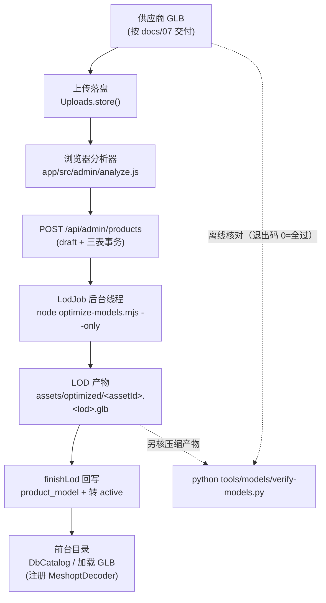

# MODEL-PIPELINE 模型交付流水线

> 注：正文里的 `docs/NN`（如 `docs/17 §2`）是**内部设计文档的编号锚点**，用于保留决策沿革；公开仓只随附 `docs/` 下的 6 份文档，编号对照见 `docs/00-index.md`。


> 本文件是本项目的**模型流水线真源**：从供应商给的 GLB 到前台能加载，中间每一步用什么脚本、验什么、回写什么。
> 它**替代**了通用模板里的「组件分发说明」——本项目没有组件库分发，有的是模型流水线。
> 交付口径以本文与 `spatial-core` 的实测脚本为准；模型验收数据在 `assets/catalog/models.verified.json`。

---

## ① 流水线总览



**每步用的脚本 / 代码**（来源 tools/models、server/src、app/src）：

| 步骤 | 脚本 / 类 | 说明 |
| --- | --- | --- |
| 上传落盘 | `server/.../admin/Uploads.java` | sha256 内容寻址 + `.part` 原子改名 |
| 浏览器分析 | `app/src/admin/analyze.js`（复用 `gltf.js` 的 `parseGlbBuffer`） | 体检 + 拾取，与前台**同一个** loader，不另写解析器 |
| 落库（draft） | `ProductWriteRepository` / `ProductDraft` | 三表（product / product_model / product_note）一个事务 |
| 异步 LOD | `server/.../admin/LodJob.java` | 调 `optimize-models.mjs --only --asset-id --out --json` |
| 压缩 + LOD | `tools/models/optimize-models.mjs` | three.js + meshopt，全量/单件两模式 |
| 离线验收 | `tools/models/verify-models.py` | 逐顶点量几何 / 门铰链 / 预算 |
| 前台加载 | `app/src/gltf.js` | 注册 MeshoptDecoder，校准（底面中心 + 等比缩放） |

---

## ② 模型交付规范（`docs/07`，最权威）

**文件与命名**：glTF 2.0 二进制 `.glb`（单文件）；文件名 `产品型号.glb`（多变体 `型号__变体.glb`）；
LOD 放 `models/{型号}/lod0.glb|lod1.glb|lod2.glb`；只用英文/数字/`-`/`_`，不要中文/空格/括号；更新不覆盖旧文件（加 `__v2`）。

**坐标与尺度（最容易错、最重要）**：

| 项 | 规定 | 理由 |
| --- | --- | --- |
| 单位 | **毫米 mm**（`1 unit = 1 mm`） | 与原项目、产品资料一致 |
| 上下方向 | **Y 轴向上** | Three.js 默认 |
| 朝向 | **正面朝 +Z** | 2D/3D 朝向一致 |
| 原点 | **底面中心**（`x/z=0` 在底面投影中心，`y=0` 在底面） | 摆放免去减半高，避免飘空/陷地 |
| 缩放 | 节点 `scale = 1`（**不预先缩放**） | 缩放由程序按包络统一做 |

**门/盖节点规范**（决定开门动画能不能做）：每扇可动门必须**独立节点**，命名 `door_upper`/`door_lower`（上下对开，轴 y）、
`door_single`（单开，轴 y）、`lid_top`（顶盖，轴 x）、`drawer_01`（抽屉，轴 x）。铰链写节点 `extras`：
`{"hinge":{"axis":"y","angle":1.85,"dir":1,"offset":[0,0,0]}}`（angle 为弧度，1.85≈106°）。

**性能预算（硬指标，超过不收）**：

| 指标 | 上限 |
| --- | --- |
| 单模型面数（LOD0） | **≤ 60,000 三角面** |
| 单模型文件（LOD0） | **≤ 3 MB** |
| LOD 级数 | **≥ 2 级** |
| 整场景 20 台 | ≤ 150 万面 |
| 纹理总量 | 单模型 ≤ 8 MB |
| 贴图尺寸 | 单张 ≤ 2048×2048，优先 WebP |

**LOD 三级目标**（tools/models/optimize-models.mjs `LODS`，行 44–48；与 `analyze.js` `LIMITS.lod0Triangles/lod0Bytes` 一致）：

| 级 | 面数预算 maxTriangles | 贴图上限 texMax | 用途 |
| --- | --- | --- | --- |
| lod0 | **60,000** | 1024 | 近景 / 单体查看 |
| lod1 | **20,000** | 512 | 常规距离（房间内多台） |
| lod2 | **6,000** | 256 | 远景 / 数量多时 |

> docs/07 §4 区分**两个尺寸**：`envelope`（声明包络 = 2D 占地矩形，不含凸出物）与 `bbox_actual`（实测包围盒，含把手/脚轮）。
> 模型按真实比例做、程序等比缩放至恰好内接包络，模型一定不越界；留白比越界/变形划算。

---

## ③ 体检 9 项

来源：`app/src/admin/analyze.js` 的 `buildChecks()`，9 个 check key；阈值逐条来自 docs/07 §6（LIMITS 常量）。
`ok = !checks.some(c => c.level === 'bad')`——**只有 `bad` 才拦人，warn 只是提醒**。
逐项「在什么情况下报坏（或报提示）」：

| # | key | 对应说法 | level | 在什么情况下发声 |
| --- | --- | --- | --- | --- |
| 1 | `parse` | 解包 | ok（前置） | 用与前台同款 loader 解析成功；**解析失败则整体抛异常，不产出 check** |
| 2 | `file` | 文件 | ok | 源文件大小。**绝不拦人**：交付口径 ≤3 MB 是**压缩后**量，源大正常（跑完 LOD 再核） |
| 3 | `triangles` | 三角面 | warn | 源面数 > 60,000 → 提示「跑完 LOD 回来看」；≤ 则 ok |
| 4 | `origin` | 原点 | warn | 底面中心在原点的偏差 > `originMm`(2 mm) → 提（前台自动纠偏，偏差记进 `delta_vs_source_json`） |
| 5 | `textures` | 纹理 | warn | 贴图估计字节 > 8 MB → 提（压缩会按 LOD 重采样到 1024/512/256） |
| 6 | `doorNodes` | 门节点 | warn | 按 docs/07 §3 约定名**一个都找不到** → 门型降级人工（不拒库） |
| 7 | `doorNaming` | 门命名 | warn | 找到了但名不符约定（如 `outer_door` 而不是 `door_single`）→ 提（改名安全） |
| 8 | `hinge` | 铰链 | warn | 有门节点但缺 `extras.hinge` → 提（靠目录 doors 补，见 docs/07 §3 退路） |
| 9 | `declared` | 与声明对账 | **bad**（唯一拦人）/ warn / ok | 单位对不上（判成米/厘米/差 1000 倍）→ **bad 拦人**；实测≠声明 → warn（**要人判**，见下）；一致 → ok；无声明 → warn |

> 第 9 条「与声明对账」是本流水线**唯一会拦人的体检项**：量纲错（m/cm）直接 `bad`，因为下游全部几何都建立在它上面。
> 而「实测 ≠ 声明」**不报 bad**——同一数字有两种完全不同的情况：① 按外观重建本就不是 1:1 → 走 `fit`（等比缩放兜底）；
> ② 供应商声称 1:1 却对不上 → 让他去对账。机器只报事实，人来判（analyze.js §declared 注释）。

门型判定靠**约定不靠猜**：`pickDoor()` 的优先级 `top > double > single > drawer`；正对面只给候选、不假装知道（拿不准给 `picked: null`）。

---

## ④ LOD 生成

脚本 `tools/models/optimize-models.mjs`；处理链「顺序是实测定的，不是习惯」（docs/10 §2）：

```
dedup → prune → 【stripNormals】 → weld → simplify → 【rebuildNormals】 → quantize → webp → meshopt
```

**先 stripNormals 再 weld**（本批最大发现）：官方模型顶点÷面=3.30（完全硬边），meshoptimizer 视为全接缝；
只去掉 NORMAL（保留 UV）就从 215,414 面降到 46,121 面；再去法线后 weld，顶点 711,627 → 20,570。
`rebuildNormals(35°)` 按折痕角重建法线（等价 Blender Shade Auto Smooth），硬边不丢、UV 不动。

**全量模式 vs 单件模式**：

| 维度 | 全量模式 | 单件模式 |
| --- | --- | --- |
| 入口 | `npm run optimize`（脚本默认） | `node optimize-models.mjs --only <源.glb> --asset-id <id> --out <目录> [--json <结果.json>]` |
| 输入 | `assets/catalog/products.json` 的全部 `asset` | 单个上传的源 GLB |
| 账本 | 写 `assets/optimized/lod.manifest.json` | **不碰** lod.manifest.json（新增产品账本记在库 `product_model.lod_json`） |
| 结果去向 | stdout + manifest | **写 `--json` 文件**（Java 读文件；stdout 只留给人看） |
| 产物 file 字段 | `assets/optimized/<id>.<lod>.glb` | **只有文件名** `<id>.<lod>.glb`（调用方知道 outDir，拼了反而两处走样） |

**「两级等效就刻意不出文件」规则**（optimize-models.mjs 272、322）：相邻两级面数差 `< 2%`
（`Math.abs(Δtriangles)/lastKept < 0.02`）时，认为已达该模型下限（保留 UV 接缝时的物理下限），
标 `skipped: true` + `equivalentTo`，**不重复出文件**。同一判据**全量/单件两模式一致**，不许两条路走出两种结论。
（E2E 实测 demo-freezer-chest 本来就有 1 级 skipped——对照存量确认「是等效不是缺陷」，docs/33。）

---

## ⑤ 入库后回写什么（`product_model`）

来源：`server/.../admin/ProductWriteRepository`、`LodJob.java`。LOD 作业成功后 `finishLod()` 回写四样并**转 active**：

| 字段 | 写入内容 | 口径 |
| --- | --- | --- |
| `file_path` | 默认加载那一级产物相对路径 | `assets/optimized/<assetId>.<lod>.glb`（`outDirRel + "/" + file`，由 Java 端拼，见 LodJob.read） |
| `file_size` | 产物字节数 | 与磁盘文件字节**逐字一致**（E2E 实测 39292） |
| `checksum` | **源级 md5，32 位十六进制** | 三级（lod0/1/2）共用同一个源 md5（与存量 `levels[*].md5` 同口径） |
| `lod_json` | 形状 `{levels, skipped, manifest}` | 见下 |

`lod_json` 组装（LodJob.read）：
- `levels[]`：未跳过的级，每项 `{md5, file, bytes, triangles}`；**不**放 `bboxMm`/`textures`（优化器不产这两个数，编一个比缺了更坏——真值在 `product_model` 的 `bbox_*` 列）。
- `skipped[]`：被等效跳过的级，每项 `{level, equivalentTo, triangles, reason:"与该级预算等效，刻意跳过"}`。
- `manifest`：`"未并入 lod.manifest.json（单件模式刻意不动它，免得动到存量产品的引用）"`。
- 空态：`{"levels":[],"skipped":[]}`（ProductWriteRepository 146 行 draft 阶段的占位）。

`checksum` 与内容寻址用 `sha256` 是**两回事**：checksum 存源级 `md5`（`LodJob.md5Of()`，MD5 算法）；上传文件落盘才是 `sha256` 命名（见 ⑥）。

---

## ⑥ 内容寻址与原子写

来源：`Uploads.java`（两条规矩都为了「出了事能查」）：

1. **上传件按 sha256 命名**：文件名 = 内容 SHA-256（`<sha256>.glb`）。同一个模型重复上传不产生第二份；URL 天然不可变 → `/api/assets` 敢给 immutable 长缓存。
2. **先写 `.part` 再原子改名**：`Files.createTempFile(dir, ".upload-", ".part")` 写全量 → `Files.move(tmp, target, ATOMIC_MOVE)`；不支持原子移动则退路「同盘 rename 本来就是原子的」。半截文件永不被下发。

另有**名字校验**（`checkGlbName()`）：只收 `.glb`，非 GLB 当场说清为什么拒（不靠 `Path.normalize` 就算完）。

---

## ⑦ 刻意不做的

- **后端不解析模型几何——「浏览器就是模型分析器」**：上传时反正要加载模型做预览，顺手拾取（体检 + 包围盒 + 门铰链），零新增组件。后端只用已有的 Node/Python 工具**对账**、调优化器，**不做实时几何解析**——否则就是两套几何代码，迟早打架（analyze.js 头注释、docs/32 §2）。
- **后端不造 bbox/纹理**：LOD 回写时刻意不放 `bboxMm` / `textures`（优化器不产，编一个比缺了更坏）。
- **单件模式不碰存量账本**：不写 `lod.manifest.json`，避免动到存量产品的引用。
- **不拿事务包住跑进程**：LOD 一个跑几十秒的子进程绝不该占着数据库连接（LodJob 头注释）。
- **草案不冒充成品**：draft 阶段 `file_path=空`、前台不可见；LOD 跑成才转 active——半成品放给使用者比干脆失败更难查。
- **等效级不硬凑文件**：触到模型下限就如实标 `skipped`，不把目标数字改小装作达标（docs/10 §2③）。

---

## 附：一条命令核对（交付方一页速查）

```bash
cd tools/models && npm install       # 只装一次（离线工具，不进生产运行时）
npm run extract && npm run catalog    # 抽取 + 目录（唯一目录 assets/catalog/products.json）
npm run optimize                      # 压缩 + LOD
npm run verify                        # 按规范核对
python tools/models/verify-models.py --dir   # 另核压缩产物（退出码 0 = 全过）
```

`verify-models.py` 关键函数（`grep '^def '`，行号见文件）：`parse_glb` / `dequant`（反量化）/
`geometry_box_indexed`（逐顶点包围盒） / `read_indices` / `read_positions_minmax` /
`verify` / `optimized_dir_from_argv` / `main`。其中 `dequant`（量化后读尺寸必须反量化，否则算出 3700 万毫米，
docs/10 §3.1）与 `geometry_box_indexed`（按索引精确，否则门盒子被撑成整机 30% 偏大，docs/12 §2）是两条真坑的产物。

`verify-models.py` 顶部预算常量（文件头 30–33 行）：`LIMIT_TRIANGLES = 60000`、`LIMIT_BYTES = 3 * 1024 * 1024`、`LIMIT_TEXTURES = 2`（贴图**张数**上限，见 docs/10 §5「贴图 ≤2 张」）。
注意与 `analyze.js` 的口径区分：`verify` 的 `budgets.textures.limit=2` 是**张数**，`analyze.js` 的 `LIMITS.textureBytes=8MB` 是**总字节**，两者维度不同。